# Catálogo de detalles: TODOS obligatorios

Son los detalles que hacen que el video se vea como el aprobado. Una versión hecha por otro agente usó el motor correcto, pero **se saltó casi todos**: no puso fotos sobre papel con su pie, ni polaroids, ni comparativa VS, ni carrusel, y casi no usó blanco y negro. Aquí está cada uno con su animación cuadro a cuadro, la función del motor que lo dibuja, cuántas veces sale en el video aprobado y dónde va.

**No hay que programarlos:** ya los hacen `src/estilo.py` y `src/render.py`. Solo hay que **ponerlos en el EDL**. `src/verificar.py` cuenta que estén.

Frecuencias medidas en el video aprobado (13:52 min, 12 paradas):

| Detalle | Veces en el aprobado | Mínimo obligatorio (12 paradas, ~14 min) |
|---|---|---|
| Apertura numerada | 12 | 1 por parada |
| Ficha "PARADA N" | 12 | 1 por parada |
| Número rojo de cifra | 24 | 1 por parada |
| Palabra gigante | 24 | 1 cada 1.5 min |
| Nota a máquina con resaltado | 11 | 1 cada 2 paradas |
| Escenas de papel (en total) | 10 | 1 cada 1.5 paradas |
| · Polaroids | 5 | 4 |
| · Foto única sobre papel con pie | 3 | 2 |
| · Comparativa VS | 1 | 1 si el guion tiene una rivalidad |
| · Carrusel de cierre | 1 | 1, al final |
| Planos en blanco y negro (pérdida) | 11 | 8 |
| Clips de video real | 35 | 25 |
| Fotos con zoom lento | 176 | todo lo demás |

---

## 1. Apertura numerada
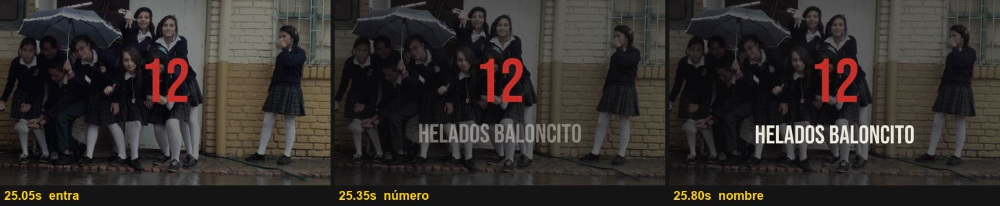
- **Qué es:** el fondo se oscurece, aparece el **número rojo gigante** (Bebas Neue, 360 px) y debajo el **nombre de la marca en mayúsculas** (Bebas, 150 px) con un leve encogimiento.
- **Cuándo va:** en el primer segundo de cada parada, sobre **una foto de esa marca**. Dura 2.3 s.
- **En el EDL:** `{"tipo":"numero","t":25.0,"dur":2.3,"num":"12","label":"Helados Baloncito","grande":true}`. En `edl_completo.py` es `abre(t, N, 'Marca')`.

## 2. Ficha "PARADA N"
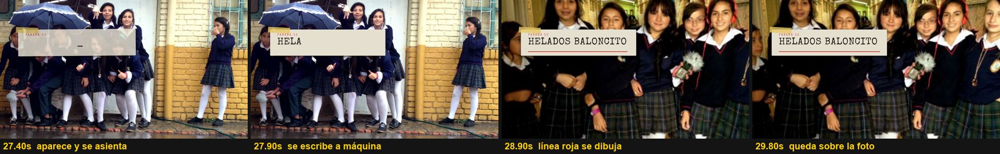
- **Qué es:** una tarjeta crema con cinta amarilla, arriba a la izquierda. Primero aparece un 10 % más grande e inclinada y se asienta en 0.12 s. Después el nombre **se escribe letra por letra**, a 22 letras por segundo, y al final **se dibuja una línea roja** debajo, en 0.5 s.
- **Detalle clave:** la ficha **sigue en pantalla aunque cambie la foto de abajo**.
- **Cuándo va:** 2.35 s después de la apertura, y dura 4 s.
- **En el EDL:** `{"tipo":"file","t":27.35,"dur":4,"texto":"Helados Baloncito","etiqueta":"Parada 12"}`.

## 3. Número rojo de cifra
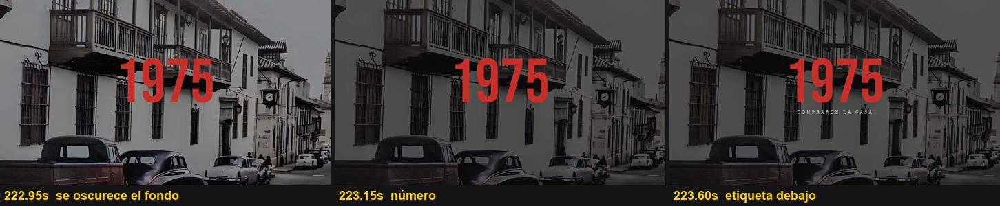
- **Qué es:** el fondo se oscurece y se desatura en 0.17 s. Aparece la cifra en rojo y, 0.3 s después, una etiqueta pequeña en letra de máquina con mucho espacio entre letras ("COMPRARON LA CASA").
- **Cuándo va:** **en el segundo exacto** en que la voz dice un año, un precio o una cantidad. Dura de 2 a 2.4 s.
- **En el EDL:** `numero(w('1975', desde, defecto), '1975', 'compraron la casa')`.

## 4. Palabra gigante
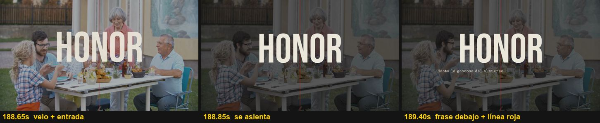
- **Qué es:** el fondo se oscurece, entra una **palabra en blanco de 400 px** que baja y se encoge hasta su lugar, debajo se escribe la **frase completa** en letra de máquina, y una **línea roja vertical delgada** cruza la pantalla.
- **Cuándo va:** en la frase emocional más fuerte y **siempre en la frase final de cada parada**. Dura de 1.7 a 3.4 s.
- **En el EDL:** `palabra(t, 'Honor', 'Hasta la gaseosa del almuerzo era una cuestión de honor.')`.

## 5. Nota a máquina con resaltado
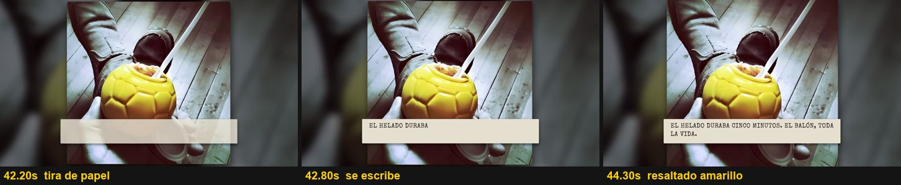
- **Qué es:** una tira de papel **abajo al centro**, sobre la foto, donde la frase se escribe y una o dos palabras quedan **resaltadas en amarillo**.
- **Cuándo va:** **solo** para lemas o frases célebres entre comillas («Siempre te da más», «Listo Medellín, cabina 8») y para frases redondas como "El helado duraba cinco minutos. El balón, toda la vida". Es corta y nunca sustituye a la imagen.
- **En el EDL:** `nota(t, '«Conavi quiere a la gente».', ['quiere a la gente'])`.

## 6. El papel que empuja + la foto única con pie
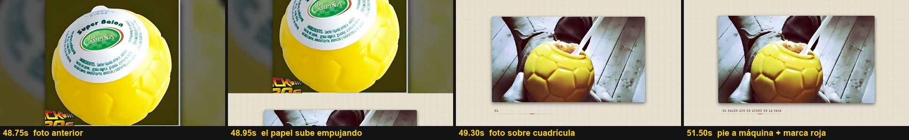
- **Qué es:** el papel cuadriculado **sube desde abajo empujando la foto anterior** en 0.5 s. Sobre el papel queda **una foto grande con esquinas redondeadas y sombra**, con zoom lento. Debajo, el **pie escrito a máquina**, una línea fina y una **marca roja corta**. Al salir, el papel también sube empujando.
- **Cuándo va:** cuando la voz se detiene en un objeto o en un recuerdo concreto ("el balón que se quedó en la casa", "los indicativos de larga distancia", "la cajita que todavía se guarda"). Dura de 4 a 7 s.
- **En el EDL:** `P('unica', [{'src': foto, 'pie': 'El balón que se quedó en la casa'}])`. El empuje lo hace `render.py` solo.

## 7. Polaroids
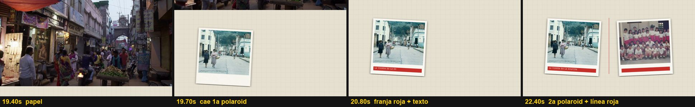
- **Qué es:** fotos con **borde blanco** que **caen inclinadas** una por una. Debajo de cada una se dibuja una **franja roja con texto a máquina**, y entre ellas **se traza una línea roja vertical**. Pueden ser 2 o 3.
- **Cuándo va:** para comparar o juntar cosas: la tienda y el colegio, la paleta y sus franjas, Caravana-Ley-Tía, la alcancía y la abejita que volvió. Dura de 5.5 a 7.5 s.
- **En el EDL:** `P('polaroid', [{'src': a, 'pie': 'La tienda de la esquina'}, {'src': b, 'pie': 'El colegio, años 90'}])`.

## 8. Comparativa VS
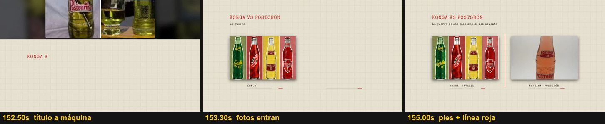
- **Qué es:** un título rojo a máquina ("KONGA VS POSTOBÓN") con un subtítulo, dos fotos lado a lado, sus pies y una línea roja al centro.
- **Cuándo va:** cuando el guion habla de una **rivalidad o competencia**. Dura unos 8 s.
- **En el EDL:** `P('vs', [{'src': a, 'pie': 'Konga · Bavaria'}, {'src': b, 'pie': 'Manzana · Postobón'}], titulo='Konga vs Postobón', sub='La guerra de las gaseosas de los noventa')`.

## 9. Carrusel de cierre
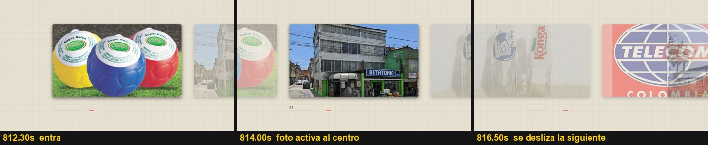
- **Qué es:** fotos de las marcas que **se deslizan de derecha a izquierda**. La foto activa queda al centro y las vecinas, transparentes, a los lados. Cada una tiene un pie "N · Marca".
- **Cuándo va:** en el **cierre**, cuando la voz repasa "doce paradas, doce marcas". Dura unos 10 s.
- **En el EDL:** `P('carrusel', [{'src': f, 'pie': '12 · Baloncito'}, …])`.

## 10. Blanco y negro para la pérdida
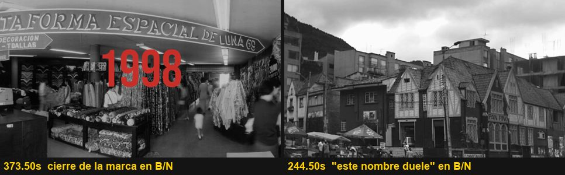
- **Cuándo va:** justo cuando la voz habla de un cierre, una quiebra o una pérdida ("cerró en 1998", "este nombre duele", "la silla quedó vacía", "se apagó").
- **En el EDL:** `"bw": true` en el plano, o el sufijo `'#bw'` en `tramos()`.

## 11. Foto pequeña o vertical enmarcada
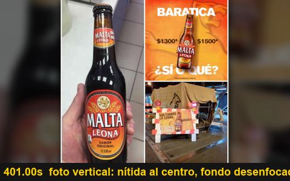
- **Qué es:** si la foto es vertical o pequeña, `render.py` la pone **nítida al centro con sombra, sobre ella misma desenfocada y oscurecida**. Así no se deforma ni se pixela.
- **Es automático,** pero lo ideal es buscar la foto horizontal y grande primero.

## 12. Zoom lento con cámara en mano
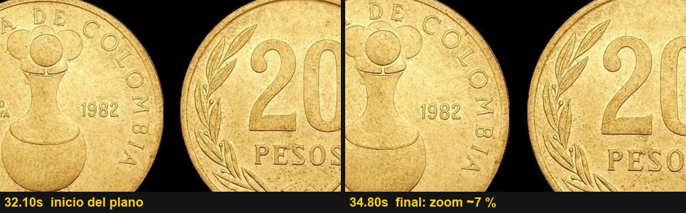
- **Qué es:** cada foto se acerca o se aleja **un 6–7 %** durante el plano, alternando la dirección, con un temblor muy leve como de cámara en mano. **Nunca hay una imagen quieta.**
- **En el EDL:** `"mov": {"z0":1.0, "z1":1.07}`. `edl_completo.py` alterna la dirección solo con `foto()`.

---

## Detalles de sonido (los pone `src/efectos.py` según el EDL, sin tocar nada)

- **Tecleo** de máquina de escribir en fichas y notas.
- **Golpe grave** en los números, más profundo en las aperturas.
- **Whoosh** en las palabras y en la entrada del papel.
- **Obturador** de cámara en cada polaroid.
- **Especiales** en `efectos.py`, que se ajustan a mano para cada guion: el ¡PLUM!, el timbre, la cinta VHS y las monedas. **En un tema nuevo** se cambian por los sonidos que nombre su guion, o se quitan.
