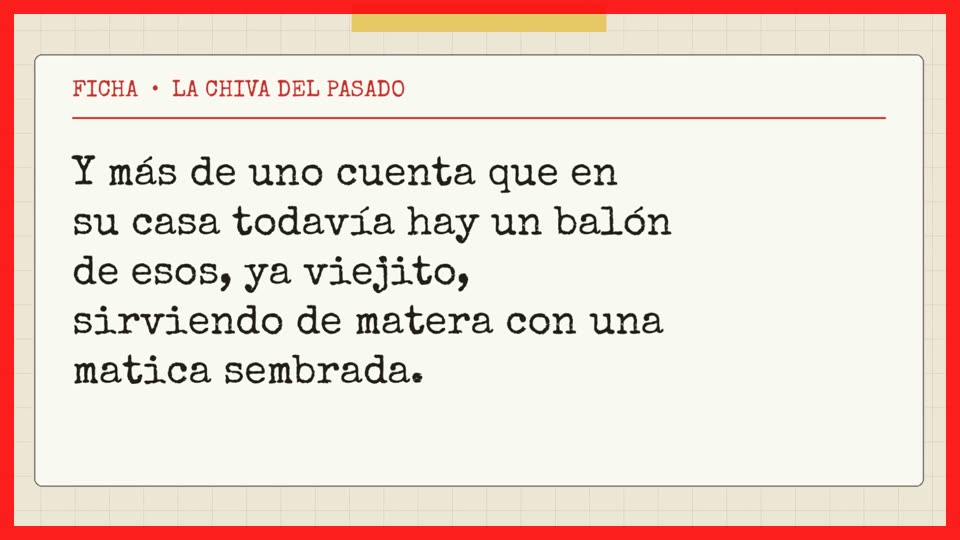
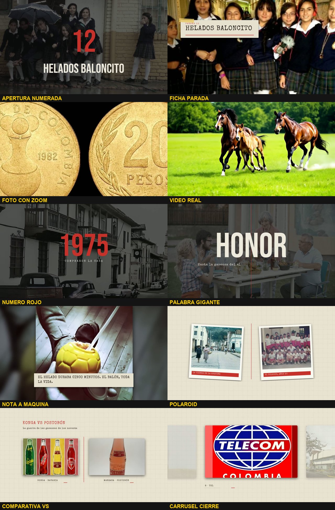

# Reglas duras (OBLIGATORIAS para cualquier IA: Claude, Muse u otra)

Luis quiere **exactamente la edición del video aprobado**, `final/12_marcas_colombianas_FINAL.mp4`. Las reglas son medibles, y `src/verificar.py` las comprueba. **Si el verificador dice NO APROBADO, el video no se entrega**: se corrige y se vuelve a medir.

```
python src/verificar.py final/MI_VIDEO.mp4 final/mi_edl.json
```

## Lo que NO se hace (pasó con una versión rechazada, el v4 hecho con otro agente)



- **PROHIBIDO escribir un editor propio o rediseñar las plantillas.** Se usa `src/render.py` + `src/estilo.py` tal cual; solo cambia el EDL. La versión rechazada hizo su propio editor, con otro diseño y sin la mitad de los recursos.
- **PROHIBIDO poner la narración escrita en tarjetas de papel** como relleno. La voz ya la dice. En la versión rechazada eso ocupó el **69 %** del video.
- **PROHIBIDO dejar una imagen o tarjeta quieta** durante muchos segundos. La versión rechazada tuvo un tramo de 51 s sin cambiar.
- **PROHIBIDO usar frames de comerciales de TV** (las hormiguitas de "Aló, Mamá", la abejita del comercial de Conavi). Content ID los detecta.
- **PROHIBIDO imágenes generadas con IA.**
- **Si no hay foto de algo:** se busca más (Google, redes, foros), se usa una foto de la época o un **clip de video real** del ambiente. **Nunca** se resuelve con texto en pantalla.

## Errores de la versión v6 (otro agente, ya con el motor del repo) — también PROHIBIDOS

El v6 corrigió el texto en tarjetas, pero el verificador lo rechazó por esto:
- **Una sola foto por parada.** La misma imagen duró 50, 70, 80 y hasta **114 s** (3 cortes por minuto). **Obligatorio: 1 imagen distinta cada 6 s como mínimo en CADA parada**, una por cada cosa que se narra. En el aprobado son de 10 a 18 imágenes por parada.
- **Fotos que no corresponden.** En la parada del Chupi Plum nunca salió un Chupi Plum, solo niños en un recreo, y esa foto se repitió en el Tía. La apertura de Conavi salió sobre la foto del Ley. **Cada apertura va sobre una foto de SU marca.**
- **Aperturas numeradas incompletas.** Solo 5 de 12. **Obligatorio: el número grande con el nombre antes de CADA ficha**, en las 12.
- **Voz acelerada un 13 %** (12:16 en vez de 13:52). **PROHIBIDO acelerar el audio** (atempo o similar). Se usa `audio/voz_final.wav` tal como sale de `src/voz.ps1`, que solo quita silencios.
- **Sin video real.** Todo eran fotos fijas. Obligatorio: unos 25 clips por cada 14 min.
- **Sin cierre.** Obligatorio: el número del total, el carrusel con una foto por marca y su número, y la palabra final hasta el último segundo.
- **Afiches y frames de comerciales** (la hormiguita de Telecom, el comercial de la abejita). Prohibidos.
- **No entregó el EDL.** **El EDL (json) se entrega siempre junto al video**; sin él, el verificador no aprueba.

## Subtítulos (SRT)

- **En la imagen NO van subtítulos**, igual que en el video de referencia.
- **Para YouTube se entrega un `.srt` aparte**, generado del guion con los tiempos de la voz:
  `python src/generar_srt.py audio/frases.json final/VIDEO.srt`
  Las líneas tienen máximo 42 caracteres, máximo 2 por subtítulo, y cada subtítulo dura entre 1 y 7 s. Se sube en YouTube Studio → Subtítulos → Subir archivo.

## Lo que se entrega siempre

1. `final/VIDEO_FINAL.mp4`
2. `final/edl.json`, el EDL con el que se renderizó
3. `final/VIDEO_FINAL.srt`
4. `final/miniatura.jpg` y `final/TEXTOS_YOUTUBE.txt`
5. La salida completa de `python src/verificar.py final/VIDEO_FINAL.mp4 final/edl.json`, que debe decir **APROBADO**

## Metas medidas (video aprobado y versión rechazada)

| Medida | Meta | Aprobado | Rechazado (v4) |
|---|---|---|---|
| Texto en papel en pantalla | **≤ 15 %** | 6 % | 69 % |
| Cortes por minuto | **≥ 12** | 13.7 | 8.2 |
| Plano más largo (EDL) | **≤ 11 s** | 10.3 s | — |
| Tramo sin corte visible | **≤ 30 s** | 28.5 s* | 50.8 s |
| Números o palabras gigantes (fondo oscurecido) | **≥ 3 por minuto** | 3.5 | 0.4 |
| Clips de video real | **≥ 25 por cada 14 min** | 35 | casi 0 |
| Fotos repetidas (sin contar el carrusel del cierre) | **0** | 0 | — |
| Aperturas numeradas (número grande + nombre) | **1 por ítem** | 12 de 12 | parcial |
| Números rojos de cifras (años, precios) | **≥ 1 por ítem** | 24 | casi 0 |
| Palabras gigantes | **≥ 1 cada 1.5 min** | 24 | 0 |
| Notas a máquina (lemas entre comillas) | **≥ 1 cada 2 ítems** | 11 | 0 |
| Voz: volumen y pausas | −16 a −13 LUFS, pausas ≤ 0.35 s | −15.4 / 0 | −14.7 / 0 ✔ |
| Velocidad de la voz (no acelerada) | 3.2 a 3.8 palabras/s | ~3.6 | ~4.0 en el v6 (acelerada) |
| Imágenes distintas por parada | ≥ 1 cada 6 s en cada parada | 10 a 18 por parada | 1 o 2 en el v6 |
| Aperturas numeradas | antes de cada ficha | 12 de 12 | 5 de 12 en el v6 |
| Cierre | carrusel + palabra final | sí | no en el v6 |
| EDL entregado | obligatorio | sí | no en el v6 |

\*Son fotos en blanco y negro muy parecidas, en las que el detector no ve el corte. La duración real de cada plano la da el EDL.

## Así debe verse cada recurso (fotogramas del video aprobado)

La versión completa, con la animación de cada detalle cuadro a cuadro y su frecuencia obligatoria, está en **[CATALOGO_DETALLES.md](CATALOGO_DETALLES.md)**. Ahí están el papel que empuja, la foto única con pie, las polaroids con franja roja, la VS, el carrusel, el blanco y negro y el zoom.



| Recurso | Cuándo se usa | Ejemplo |
|---|---|---|
| Apertura numerada | primer segundo de cada ítem: número rojo grande + nombre en mayúsculas (2.3 s) | `referencia/01_apertura_numerada.jpg` |
| Ficha "PARADA N" | 2.35 s después de la apertura, arriba a la izquierda, sobre la foto | `02_ficha_parada.jpg` |
| Foto con zoom lento | la base del video: **la foto real de lo que se narra**, de 2 a 6 s | `03_foto_con_zoom.jpg` |
| Video real | ambientes y acciones, cerca de 1 de cada 6 planos | `04_video_real.jpg` |
| Número rojo | en el segundo exacto en que la voz dice un año o una cifra | `05_numero_rojo.jpg` |
| Palabra gigante | en la frase emocional más fuerte y al final de cada ítem | `06_palabra_gigante.jpg` |
| Nota a máquina | **solo** para lemas o frases célebres entre comillas, abajo y corta, **sobre una foto** | `07_nota_a_maquina.jpg` |
| Polaroid / VS / carrusel | 1 o 2 por ítem, de 6 a 8 s, con fotos reales | `08`, `09`, `10` |

**La pantalla casi siempre es una FOTO o un VIDEO real** que muestra lo que se narra. Los textos son acentos cortos encima de la imagen, nunca el contenido principal.

## Orden de trabajo obligatorio

1. Leer `README.md`, `docs/IMAGENES_Y_SINCRONIA.md` y este archivo.
2. Bajar las fotos **reales** de cada cosa narrada (una búsqueda por cosa, unas 10 por ítem).
3. Armar el EDL con **`src/nuevo_video.py plan`** (esqueleto automático con toda la estructura), rellenar los `PENDIENTE` y los `REVISAR`, y comprobar con `src/nuevo_video.py validar`. **No se arma el EDL desde cero ni con otra estructura.**
4. Renderizar **un demo de 1 minuto** y pasarle `src/verificar.py`. Luis lo aprueba.
5. Renderizar el video completo, pasarle `src/verificar.py` y entregarlo **solo si sale APROBADO**.
